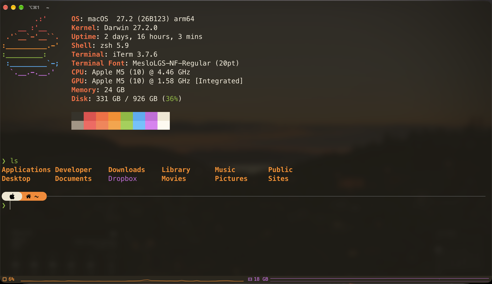

# macOS Setup

A reproducible setup for my Mac: the terminal, the editor, Python, LaTeX, the apps I use and a handful of macOS settings. One script, `install.sh`, builds all of it on a freshly erased Mac, and the configuration files in this repository stay the single source for it afterwards.

The terminal look (iTerm2 in the Høst colours, Powerlevel10k, fastfetch) is meant to be usable by anyone. See [Only want the look?](#only-want-the-look).



*iTerm2 + Powerlevel10k + fastfetch on macOS 27 (Apple M5), in the Høstkveld colours.*

---

## Contents

1. [Quick start](#quick-start)
2. [Only want the look?](#only-want-the-look)
3. [What install.sh does](#what-installsh-does)
4. [After install.sh](#after-installsh)
5. [Reference](#reference): [Homebrew](#homebrew-and-the-brewfiles), [Terminal](#terminal), [Git](#git-and-github), [Claude](#claude), [Python](#python), [VS Code](#vs-code), [LaTeX](#latex), [Apps](#apps), [macOS settings](#macos-settings)
6. [Maintenance](#maintenance)
7. [Before erasing a Mac](#before-erasing-a-mac)
8. [Useful links](#useful-links)

---

## Quick start

On a new or freshly erased Mac, after the Setup Assistant (sign in with your Apple ID there; do not use Migration Assistant or restore from Time Machine):

Open **Terminal.app** and run these three commands, one at a time.

```bash
/bin/bash -c "$(curl -fsSL https://raw.githubusercontent.com/Homebrew/install/HEAD/install.sh)"
```

This installs Homebrew, and with it Apple's Command Line Tools (git, compilers). It asks for your password. When it finishes it prints "Next steps" with commands that add Homebrew to your PATH. You can skip them: `install.sh` finds Homebrew by itself and sets up the PATH for every new terminal. Running them does no harm either.

```bash
mkdir -p ~/Developer && git clone https://github.com/dagmortensj/mac-setup ~/Developer/mac-setup
```

```bash
cd ~/Developer/mac-setup && ./install.sh
```

At the start, `install.sh` asks for your name and email for git (only the first time) and for your password, which it needs for the macOS settings at the end. Homebrew asks for the password again, by itself, when it installs MacTeX, Teams and Logi Options+; it deliberately does not reuse an earlier one. So stay near the Mac until those are done. MacTeX is the slow part, about 6 GB, and its password prompt comes when the download has finished. If a prompt is left unanswered for a few minutes, that step fails; run the group again afterwards. Every step prints one line, and the full output is written to a log in `~/Library/Logs/mac-setup/`.

When it is done, log out and in again and go through [After install.sh](#after-installsh).

The repository should live in `~/Developer/mac-setup`. The script works from anywhere, but my VS Code settings (synced through Settings Sync) expect that path.

---

## Only want the look?

If you just want the terminal as it looks in the screenshot:

```bash
git clone https://github.com/dagmortensj/mac-setup
cd mac-setup && ./install.sh terminal
```

This installs iTerm2, the MesloLGS NF font and fastfetch with Homebrew (install Homebrew first), sets up Oh My Zsh with Powerlevel10k and two plugins, and links `~/.zshrc`, `~/.zprofile`, `~/.p10k.zsh` and the fastfetch config to the files in your clone. Files already in those places are moved to `~/.mac-setup-backup/` first. If iTerm2 already has settings on your Mac, they are left alone; the [Terminal](#terminal) section explains how to import mine anyway.

Only the colours? Double-click `Høstkveld.itermcolors` or `Høstlys.itermcolors` in [`configs/iterm2/farger/`](./configs/iterm2/farger/) and pick the preset under **iTerm2 → Settings → Profiles → Colors → Color Presets**.

The other groups are personal. Before running them on your own Mac, go through these files:

| File | What is personal in it |
|---|---|
| [`configs/brew/apps.Brewfile`](./configs/brew/apps.Brewfile) | My apps |
| [`configs/repos.txt`](./configs/repos.txt) | My repositories |
| [`configs/macos/defaults.sh`](./configs/macos/defaults.sh) | My macOS settings (dark mode, trackpad, Dock, Finder) |
| [`install.sh`](./install.sh), `macos` group | The pmset change for a Studio Display, and removal of GarageBand and iMovie |
| [`configs/zsh/.zshrc`](./configs/zsh/.zshrc) | fastfetch on every new terminal, and the `pyadd` functions |

Your git identity is not in the repository. `./install.sh dev` asks for it and stores it in `~/.gitconfig.local`.

---

## What install.sh does

```text
./install.sh                  everything: terminal dev apps repos macos
./install.sh terminal         one group
./install.sh dev macos        several groups (always run in the order above)
./install.sh --dry-run        show what would happen, change nothing
./install.sh --skip-casks     install command-line tools but no apps
```

| Group | Steps |
|---|---|
| `terminal` | [`terminal.Brewfile`](./configs/brew/terminal.Brewfile) (git, fastfetch, iTerm2, MesloLGS NF) · links `~/.zshrc`, `~/.zprofile`, `~/.p10k.zsh`, `~/.config/fastfetch/` · `~/.hushlogin` · Oh My Zsh · zsh-autosuggestions, zsh-syntax-highlighting, Powerlevel10k · iTerm2 settings (only if iTerm2 has none yet) |
| `dev` | [`dev.Brewfile`](./configs/brew/dev.Brewfile) (gh, gcc, progress, uv, VS Code, MacTeX) · links `~/.gitconfig` · creates `~/.gitconfig.local` · links `~/.config/latexmk/latexmkrc` and `~/.config/uv/uv.toml` · builds the Python standard environment · points VS Code at it · installs the home-made VS Code extensions |
| `apps` | [`apps.Brewfile`](./configs/brew/apps.Brewfile) |
| `repos` | clones the repositories in [`repos.txt`](./configs/repos.txt) into `~/Developer` · links `~/.claude/CLAUDE.md` and `~/Developer/CLAUDE.md` (see [Claude](#claude)) |
| `macos` | [`defaults.sh`](./configs/macos/defaults.sh) · pmset for the Studio Display · removes GarageBand and iMovie if present (if macOS refuses, because Terminal lacks the App Management permission, drag them to the Bin instead) |

How it behaves:

- **Every step prints OK, SKIP or FAIL.** A failed step does not stop the others; the summary lists what failed, and the log has the details. Fix the cause and run the script, or just that group, again.
- **It can be run again at any time.** Homebrew only installs what is missing and never upgrades what is there (`brew bundle --no-upgrade`, so a re-run cannot start a 6 GB MacTeX download). Links that are already right are left alone. Repositories that are already cloned are not touched. iTerm2 settings are only imported when iTerm2 has none.
- **Nothing is overwritten.** A file that is in the way of a link is moved to `~/.mac-setup-backup/<date>/` first. If it differed from the repository's version, the summary names it, so you can compare before deleting the backup.
- **Questions come first, where possible.** The git identity and the password for the `macos` group are asked for at the start, and a background loop keeps `sudo` active. Homebrew asks for the password itself when a cask's installer needs it (MacTeX, Teams, Logi Options+); since version 7 it resets any earlier `sudo` on purpose. `caffeinate` keeps the Mac awake meanwhile.
- **`--skip-casks`** is for a Mac where the apps were installed by hand. Homebrew would otherwise try to install them again and fail on the ones that already exist, and download MacTeX a second time.
- It is written for the bash 3.2 that ships with macOS, and stops before changing anything if it is not on an Apple Silicon Mac, if Homebrew is missing, or if it is run with `sudo`.

---

## After install.sh

Some things cannot be scripted. The script prints this list at the end of a full run.

1. **Log out and in again**, so that every macOS setting takes effect.
2. **Sign in**: Dropbox (choose the folders and let it finish syncing), Teams, Outlook, and Claude (connect its folders again).
3. **GitHub**: run `gh auth login`, choose HTTPS, and answer **No** to "Authenticate Git with your GitHub credentials?". `install.sh` has already told git to get the token from gh; answering Yes would make gh write the same thing into the shared `.gitconfig` in this repository.
4. **VS Code**: turn on Settings Sync (gear icon → Settings Sync) with GitHub and choose **Merge**. Settings, keybindings, extensions and the profiles arrive. Then run `./install.sh dev` once more, so the profiles that Sync brought in also get the Python setting and the home-made extensions.
5. **App Store**, under your account → Purchased: Word, Excel, PowerPoint, Outlook, OneNote, Pages, Numbers, Keynote, GeoGebra Classic 6, AdGuard for Safari. (Erasing a Mac removes Pages, Numbers and Keynote too.)
6. **Download yourself**: SAFEQ Client (from school) and PASCO Capstone.
7. **Safari web apps**: open Gmail and YouTube in Safari and use File → Add to Dock.
8. **Set by hand**: Night Shift, display scaling, Control Center and the menu bar icons, Spotlight categories, the lock screen clock, the apps in the Dock.
9. **Check** in System Settings that the settings from [`defaults.sh`](./configs/macos/defaults.sh) took effect. Apple sometimes renames a setting, and then the line runs without doing anything.
10. **Permissions**: grant access under Privacy & Security when an app asks (Logi Options+, Dropbox, iTerm2). Rosetta is installed on demand the first time Steam or a game needs it.

Also check:

- `python3 -c "import numpy, matplotlib, tkinter"` in a new terminal works without errors.
- In VS Code, a Python file shows `standard` (or `~/.venvs/standard`) as the interpreter in the status bar, and a notebook offers it as kernel.
- The prompt shows its icons in iTerm2 and in the VS Code terminal (if not, the font is missing).

---

## Reference

### Homebrew and the Brewfiles

[Homebrew](https://brew.sh) installs almost everything. The packages are listed in three Brewfiles in [`configs/brew/`](./configs/brew/), one per group, so that someone who only wants the terminal look installs only what it needs.

The Brewfiles are curated by hand. Do not regenerate them with `brew bundle dump`: it writes every package on the machine into the file, dependencies and leftovers included, and marks them all as wanted, so that `brew autoremove` can never clean them up again.

To install one Brewfile by hand: `brew bundle --no-upgrade --file=configs/brew/dev.Brewfile`.

Homebrew lives in `/opt/homebrew` on Apple Silicon. `~/.zprofile` adds it to the PATH with `brew shellenv`.

### Terminal

#### iTerm2

[iTerm2](https://iterm2.com/) replaces Terminal.app: true colour, split panes, a hotkey window, better search.

Its settings are kept as a snapshot in [`configs/iterm2/com.googlecode.iterm2.plist`](./configs/iterm2/com.googlecode.iterm2.plist). On a new Mac, `install.sh` imports it with `defaults import` before iTerm2 is opened for the first time. After that iTerm2 keeps its settings in the usual place on the Mac, and the snapshot in the repository only changes when you export it again (see [Maintenance](#iterm2-settings)). The snapshot leaves out everything iTerm2 rewrites by itself, such as window positions, update checks and its own counters, and the working directory of a profile that does not start in one, so `git diff` only shows real changes.

To import the snapshot on a Mac where iTerm2 already has settings (this replaces them): quit iTerm2, then from Terminal.app run

```bash
defaults import com.googlecode.iterm2 configs/iterm2/com.googlecode.iterm2.plist
```

**Colours.** The terminal uses the Høst palette from the VS Code themes (red, rust, orange, green, blue, plum), as iTerm2 colour presets in [`configs/iterm2/farger/`](./configs/iterm2/farger/): `Høstkveld.itermcolors` (dark, a little brighter and more saturated than the VS Code theme, since the window is semi-transparent and a terminal is used in short sessions) and `Høstlys.itermcolors` (light). Both are copies from the [Høst repository](https://github.com/dagmortensj/hoest-theme), where they are generated from the same palette as the VS Code themes, and both are also inside the settings snapshot. The cyan slot holds rust, so all six palette colours are available to fastfetch, the prompt and `ls`, and turquoise never appears.

**Windows.** These are part of the snapshot; this is what they are, in case they ever have to be set by hand.

- **Appearance → General → Theme: Minimal.** The title bar, tab bar and status bar all take the terminal background, so the window chrome follows Høstkveld/Høstlys with the system appearance.
- **One big window, never resized.** Resizing an iTerm2 window back and forth garbles the prompt (the `─` line between the left and right prompt reaches the right edge, and zsh cannot redraw it correctly after the terminal reflows), so the window is sized once and left alone.
- **Hotkey Window** (⌥Space) for quick commands: a second profile named `Hotkey Window`, full-width from the top of the screen, on all Spaces. It drops down over whatever is open and hides again on the same key. `~/.zshrc` skips fastfetch in it.
- **General → Window → Native full screen windows: off.** macOS full screen gives the window its own Space with nothing behind it, so transparency has nothing to show through; iTerm2's own full screen keeps it.
- **Titles:** window and tab titles show only the current path. Oh My Zsh sets them (`ZSH_THEME_TERM_TITLE_IDLE` and `ZSH_THEME_TERM_TAB_TITLE_IDLE` in `~/.zshrc`), and **Profiles → General → Title** is set to *Session Name* only, so iTerm2 does not append the job.
- **Profiles → Terminal → Show mark indicators: off.** The prompt character already turns red after a failed command; the blue triangles say the same thing in the wrong colour.

#### zsh and Oh My Zsh

[Oh My Zsh](https://ohmyz.sh/) manages plugins and themes for the zsh that ships with macOS. `install.sh` installs it unattended and keeps the linked `~/.zshrc`. The plugins, in [`configs/zsh/.zshrc`](./configs/zsh/.zshrc):

```zsh
plugins=(git
         vscode
         zsh-autosuggestions
         zsh-syntax-highlighting)
```

`git` and `vscode` come with Oh My Zsh (aliases such as `gst` for `git status` and `vsc .` to open the current folder). zsh-autosuggestions greys out a suggestion from your history as you type, and zsh-syntax-highlighting colours the command line; it has to be the last plugin, since it colours what the others have set up. Both are cloned into `~/.oh-my-zsh/custom/plugins/`.

The command line is coloured with the same roles as the VS Code theme in Høstkveld: `for`, `if` and the other reserved words in bold orange, quoted text in blue, `$variables` inside quotes in plum, options such as `-la` in rust, comments and history suggestions in grey, and a mistyped command in bold red. `ls` shows folders in bold orange and symlinks in plum (`LSCOLORS`). All of this uses the terminal's colour slots, so it follows the iTerm2 preset.

`~/.zshrc` runs fastfetch when a terminal opens, except in the hotkey window and the VS Code terminal. `~/.hushlogin` (an empty file) hides the "Last login" line, so fastfetch is the first thing on screen.

The shell configuration is split in two: [`.zprofile`](./configs/zsh/.zprofile) sets the PATH (Homebrew, then the Python standard environment in front of it) and is read by login shells, which is what iTerm2 and the VS Code terminal start; [`.zshrc`](./configs/zsh/.zshrc) has everything else.

#### Powerlevel10k

[Powerlevel10k](https://github.com/romkatv/powerlevel10k) is the prompt. Its configuration is [`configs/zsh/.p10k.zsh`](./configs/zsh/.p10k.zsh). `p10k configure` runs the wizard again, but see [Maintenance](#editing-the-config-files) first: it rewrites the file.

The prompt uses the Høst colours: the path segment is orange, the git segment is green when clean, rust when there are uncommitted changes and red in a conflict, and an activated Python environment is plum. The segments use the Høstkveld colours as fixed hex values with dark text in both themes, since the prompt is part of the interface rather than of the code and the dark Høstlys oranges do not carry dark text well. iTerm2 interprets 24-bit colours from escape codes as Display P3 rather than sRGB, so `.p10k.zsh` sends it the same colours converted to P3 coordinates; in VS Code and other terminals the sRGB values are used.

#### Font

The prompt needs a font with extra glyphs (folder icons, git branch arrows, the Apple logo). iTerm2, the VS Code editor and the VS Code terminal all use **MesloLGS NF**, the version of Meslo patched for Powerlevel10k, from the cask `font-meslo-for-powerlevel10k`. The general Nerd Fonts cask `font-meslo-lg-nerd-font` installs a font with a different name ("MesloLGS Nerd Font"), which the settings here do not use.

#### fastfetch

[fastfetch](https://github.com/fastfetch-cli/fastfetch), the maintained successor to the archived neofetch, prints the Apple logo and system details. The config in [`configs/fastfetch/`](./configs/fastfetch/) shows OS, kernel, uptime, shell, terminal, terminal font, CPU, GPU, memory and disk, with labels in rust. The logo is fastfetch's small macOS logo, kept as a local copy in `eple.txt` so each stripe gets its own colour: red, rust, orange, green, blue and plum from the top. Below it, two rows of colour blocks show black, the six palette colours and white, normal and bright.

### Git and GitHub

`~/.gitconfig` is a link to [`configs/git/.gitconfig`](./configs/git/.gitconfig), which holds only settings that suit anyone (`main` as default branch, merge on pull). It ends by including `~/.gitconfig.local`, which `install.sh` creates and which never goes into the repository. It holds:

- your name and email;
- the GitHub sign-in: git asks `gh` for the token over HTTPS. An empty `helper =` line comes first, which switches off the macOS keychain helper that Homebrew's git sets, so a renewed token is always picked up.

Sign in once with `gh auth login` (see [After install.sh](#after-installsh)). SSH keys are not used.

Because `~/.gitconfig` is a link, `git config --global …` writes into the repository's file. Personal settings belong in the local file: `git config --file ~/.gitconfig.local …`.

### Claude

Instructions for Claude live in `CLAUDE.md` files. Each repository has its own, committed in that repository, so it comes along whenever the repository is cloned. The two that belong to the working environment rather than to a repository are kept here, in [`configs/claude/`](./configs/claude/): `claude-code/CLAUDE.md` for `~/.claude/CLAUDE.md`, and `developer/CLAUDE.md` for `~/Developer/CLAUDE.md`.

Claude Code reads `~/.claude/CLAUDE.md` in every folder it is opened in, so that file only holds what it needs when helping with documents in VS Code: the LaTeX conventions, the rules for physics solutions and Norwegian terminology, and the writing style. In `~/Developer` it also reads `developer/CLAUDE.md`, and in the subject folders in Dropbox the `CLAUDE.md` there. The same LaTeX rules therefore stand in several files, and in the preferences on claude.ai, because Claude Code and the Claude app do not read the same files; a rule that changes has to be changed in all of them. The `repos` group links them into place with relative links, which also work inside Claude's own shell, where the folders are mounted under a different path. Edit them through the link; the change shows up in this repository.

This repository's own [`CLAUDE.md`](./CLAUDE.md) is an ordinary committed file.

### Python

There is one Python environment for everything that is not a project of its own: small scripts in the teaching folders, quick calculations, notebooks. It is defined in [`configs/python/`](./configs/python/) and built in `~/.venvs/standard` by [uv](https://docs.astral.sh/uv/).

- [`pyproject.toml`](./configs/python/pyproject.toml) lists the packages (numpy, matplotlib, jupyter), and [`uv.lock`](./configs/python/uv.lock) pins the exact version of each, so every Mac gets the same environment.
- Python is pinned to 3.13 ([`.python-version`](./configs/python/.python-version)), and uv only uses Pythons it has installed itself. Homebrew's Python is not used at all, so a Homebrew upgrade cannot break the environment. uv's Python includes tkinter, so `turtle` works.
- `~/.zprofile` puts `~/.venvs/standard/bin` first on the PATH: `python3 script.py` in a terminal and ⌘R in VS Code use it without any activation.
- Packages are added and removed with three functions from `~/.zshrc`, which update the package list, the lock file and the environment together:

  ```bash
  pyadd scipy       # add a package
  pyremove scipy    # remove it
  pyupgrade         # upgrade everything to the newest versions
  ```

  Commit `pyproject.toml` and `uv.lock` afterwards. Do not use `pip install`: a package installed that way is not in the list, and the next `uv sync` removes it.

A project of its own (a repository with its own dependencies, such as `schroedinger`) has its own environment in a `.venv` folder inside the project. After cloning, one command builds it from the project's `pyproject.toml`:

```bash
uv sync                  # add --extra test for optional dependencies, if the project has them
uv run pytest            # uv run uses the project's environment, no activation needed
```

The first `uv sync` writes `uv.lock`; commit it so the environment is the same everywhere. A new project starts with `uv init` and `uv add …`.

`pyrun file.py` (from `~/.zshrc`) runs a file with the right Python: the `.venv` of the project the file is in, found by looking in the current folder and the folders above it, or the standard environment when there is none. ⌘R in VS Code uses it, so loose teaching files and project files both just run.

[`configs/uv/uv.toml`](./configs/uv/uv.toml), linked to `~/.config/uv/uv.toml`, makes every project use only Pythons that uv installed itself, like the standard environment.

To move to a newer Python later, change `.python-version` and `requires-python` in `pyproject.toml`, then run `pyupgrade`.

### VS Code

VS Code and Settings Sync (with GitHub) own the settings. They are changed in VS Code, and Sync carries settings, keybindings, snippets, the Marketplace extensions, the interface state (which icons and panels are hidden) and the profiles to a new Mac and to any other computer. The rule is the same for both profiles.

[`configs/vscode/`](./configs/vscode/) holds a copy of the settings (`default/settings.json` and `writing/settings.json`), the shared `keybindings.json` and the extension list, as a record in git and for a Mac where Sync is not available. [`setup.sh`](./configs/vscode/setup.sh) moves them in either direction:

| Command | What it does |
|---|---|
| `setup.sh check` | Reports anything that is not as it should be, and changes nothing: profiles other than Default and Writing, a settings file that differs from the copy here, a home-made extension that is missing, misplaced or different from the one in the repository, a `.vsix` that does not match its source, and leftover backup files |
| `setup.sh save` | Copies the Mac's settings, keybindings and extension list into the repository. Run it now and then, and commit. It refuses to save the Default settings while classroom mode is on |
| `setup.sh restore` | Copies the repository's settings and keybindings onto the Mac, and creates the Writing profile if it is missing. A file it replaces is first moved to `settings-backup/` in VS Code's User folder |
| `setup.sh restore --extensions` | The same, and installs the extensions: for a Mac without Settings Sync, or to reinstall a home-made extension that has changed |

`save` and `restore` take `default` or `writing` as a further argument, to handle one profile only.

`install.sh` adds what Sync cannot carry:

- **tex-oppstart**, a small home-made extension that opens `main.tex` and the PDF viewer when a folder with `main.tex` is opened. None of the home-made extensions is on the Marketplace, and Sync only restores Marketplace extensions. Source and `.vsix` of each are in its folder under [`configs/vscode/`](./configs/vscode/); rebuild one with `npx @vscode/vsce package` in that folder. That needs Node.js, which this setup does not install: `brew install node`, build, and `brew uninstall node` again.
- **tex-preambel**, used only in the *Writing* profile. It folds the preamble of a `.tex` file into one line when the file is opened, so the text begins at `\begin{document}`; click the folded line to open it.

- **workspace-switcher**, in both profiles. It puts a button at the left end of the status bar, with the name of the open workspace; a click opens the next `.code-workspace` file in `configs/vscode/workspaces/` in the same window, so with two workspaces the button toggles between them. Before the name, in the corner, stands a small cross that closes the workspace and leaves an empty window in the same profile, for the times when loose folders are opened instead; there the button reads `workspace`. The button switches workspace only. A profile is never switched by hand: VS Code remembers it per workspace, so `skriving.code-workspace`, once set to the Writing profile, brings that profile with it.

- **classroom-mode**, in the Default profile. A button with a mortarboard at the right end of the status bar turns classroom mode on and off: the setup for showing code on a projector, with the Høstlys theme, font size 20, and no suggestions, hovers, light bulbs, red squiggles, auto-closing brackets or format-on-save, so that what gets typed stays exactly as typed. Nothing is reloaded, so the open file, the cursor and the other extensions are untouched, and it works in whatever folder is open. While the mode is on the button is highlighted and reads *Classroom*. What the mode means is written in one place, the setting `classroomMode.settings` (its default is in the extension's `package.json`). Turning it on writes those values into the user settings, as every toggle in VS Code does, and remembers what each was before; turning it off puts exactly those back. The mode therefore survives a restart, and stays on until the button is clicked. It was a separate profile at first; a profile reloads the window and binds the folder to itself, which does not suit a mode that is used on the same folders as the Default profile.

- **The Python interpreter** (`python.defaultInterpreterPath`, pointing at `~/.venvs/standard`). It is a machine setting, which Sync leaves out on purpose, so the script writes it into the local settings of every profile.
- **No environment activation in the terminal** (`python-envs.terminal.autoActivationType: off` and `python.terminal.activateEnvironment: false`). The standard environment is already first on PATH. When VS Code activates it, it types an activation command into a new terminal, and that collides with the command ⌘R types, which leaves the terminal at a `dquote>` prompt.

**Workspaces.** Multi-root workspaces are kept as `.code-workspace` files in [`configs/vscode/workspaces/`](./configs/vscode/workspaces/) and opened from there (File → Open Workspace from File). `undervisning.code-workspace` opens the subject folders in `Dropbox/jobb-vgs/` that are in use, and `skriving.code-workspace` is the workspace for the Writing profile, with the writing folder. The workspace-switcher button in the status bar switches between them, and its cross leaves them. The folders are stored as paths relative to the workspace file, so they resolve while the repository is in `~/Developer/mac-setup` and Dropbox is in its default place, `~/Library/CloudStorage/Dropbox`.

**Profiles.** *Default* is the everyday profile for LaTeX and Python. Spell-check (Norwegian Bokmål and English together) runs only in LaTeX and Markdown, skips commands, labels, references and all mathematics, and marks issues with a faint dotted underline; its word list is [`configs/cspell/ordliste.txt`](./configs/cspell/ordliste.txt), read straight from this repository. LaTeX Workshop builds with a single `latexmk` recipe without an engine flag; each project's `.latexmkrc` picks the engine, and `~/.config/latexmk/latexmkrc` decides for projects without one. Python files are formatted with autopep8 on save. Classroom mode, described above, is this profile's setup for showing code in class. *Writing* is for writing prose in LaTeX with nothing else on screen: the Høstlys theme at font size 15, no line numbers, tabs, suggestions, hovers or squiggles, the folder tree in the left sidebar and the preamble folded away. LaTeX commands, environment names, labels and references are set in the same grey as the braces, so the prose is what stands in full contrast; mathematics and section titles keep the theme's colours. It has LaTeX Workshop, the spell checker, tex-preambel and the workspace button, and neither Python, Claude Code, classroom mode nor tex-oppstart: the profile is only used in the writing workspace, where files are opened from the folder tree. `configs/vscode/setup.sh restore --extensions` creates it on a Mac that has neither it nor Settings Sync.

Both profiles use my own themes, Høstlys and Høstkveld (`dagmortensj.hoest-theme` on the Marketplace, developed in [hoest-theme](https://github.com/dagmortensj/hoest-theme)), with a status bar button that switches between them.

**Keybindings**

| Keys | Action |
|---|---|
| `Cmd+B` / `Alt+Cmd+B` / `Cmd+J` | Left sidebar / right panel / bottom panel (VS Code defaults) |
| `Cmd+S` | Save only |
| `Cmd+R` in Python | Save and run the file with `pyrun` in the integrated terminal, from the file's folder (the project's `.venv` if there is one, otherwise the standard environment) |
| `Cmd+R` in LaTeX | Save and build |
| `Alt+E` | SyncTeX: jump from source to PDF |
| `Ctrl+Cmd+Z` | Zen mode |
| `Ctrl+Cmd+S` | Spell-check on/off |

The integrated terminal uses `MesloLGS NF` and zsh, and *Open in External Terminal* (⇧⌘C) opens iTerm2.

### LaTeX

MacTeX is installed with Homebrew as `mactex-no-gui`: the full TeX Live distribution without TeXShop, BibDesk and LaTeXiT, since editing happens in VS Code. The cask downloads the official `MacTeX.pkg` (about 6 GB) and runs Apple's installer, so the result is the same as downloading it from tug.org. Use the cask `mactex` instead if you want the GUI apps.

Packages are updated with `tlmgr` (the TeX Live manager), not with Homebrew:

```bash
sudo tlmgr update --self
sudo tlmgr update --all
```

Homebrew only comes in when a new TeX Live year is released. `brew upgrade` then downloads the whole package again, and a plain `brew upgrade` starts that download without warning. `brew pin` does not work on casks, so upgrade formulae and casks separately and take MacTeX when you want it:

```bash
brew upgrade --formula                  # routine upgrades, never touches casks
brew upgrade --cask mactex-no-gui       # when you want the new TeX Live year
```

The global latexmk configuration, [`configs/latexmk/latexmkrc`](./configs/latexmk/latexmkrc), is linked to `~/.config/latexmk/latexmkrc`. It is a fallback for projects without their own `.latexmkrc` and picks LuaLaTeX when the main file or a local `.sty`/`.cls` uses fontspec, unicode-math or Lua, and pdfLaTeX otherwise.

[`scripts/unwrap-tex.py`](./scripts/unwrap-tex.py) rewrites `.tex` files that have hard line breaks inside paragraphs, so that each paragraph becomes one line (VS Code soft-wraps them). It changes the files in place and leaves the preamble, comments, mathematics, tables, code and TikZ alone, so the PDF stays the same: `python3 scripts/unwrap-tex.py file.tex`.

### Apps

[`apps.Brewfile`](./configs/brew/apps.Brewfile) installs Claude, Dropbox, Microsoft Teams, Google Chrome, Discord, Steam, Qobuz and Logi Options+. All of them update themselves; Homebrew knows that and leaves them alone on a plain `brew upgrade`. Removing one with `brew uninstall --cask --zap <name>` also removes the settings and support files it leaves behind.

App Store apps (Office, Pages, Numbers, Keynote, GeoGebra, AdGuard) are installed by hand from the App Store, which takes a couple of minutes. A command-line tool for the App Store exists (`mas`), but it is unofficial and the least reliable part such a setup could have, so it is not used here.

Xcode is not installed. Homebrew, git, gcc, Python and MacTeX only need the Command Line Tools, which the Homebrew installer brings.

### macOS settings

[`configs/macos/defaults.sh`](./configs/macos/defaults.sh) sets, with `defaults write`: dark mode; orange accent, highlight and icon colour; text size L; Norwegian quotation marks «» and ‘’; natural scrolling off, tap to click, pointer speed 1.5, no swipe between pages; Dock icon size 53, no recent apps, minimise into the app icon, no bottom-right hot corner; Finder in column view with the path bar, searching the current folder, no recent tags, new windows in iCloud Drive; clicking the wallpaper does not reveal the desktop, no margins between tiled windows; the weekday in the menu bar clock. Each line is commented. Some only take effect after logging out.

To find out what a setting is called: `defaults read > before.txt`, change it in System Settings, `defaults read > after.txt`, `diff before.txt after.txt`. The changed key becomes a new line in the file.

#### Studio Display fan during sleep

The Studio Display's fan spun up every 15 to 20 minutes while the MacBook was asleep. The cause was the MacBook's maintenance wakes (Power Nap and TCP keepalive), visible as `rtc/SleepService`, `rtc/Maintenance` and `wifibt ... E_TKO_TCP` entries in `pmset -g log`; each wake woke the display. The `macos` group switches both off:

```bash
sudo pmset -a powernap 0          # no Mail, Calendar, iCloud or Time Machine syncing during sleep
sudo pmset -c tcpkeepalive 0      # on the charger: no waking to keep network connections
```

Find My does not update the location while the Mac sleeps on the charger, which is fine for a docked Mac. Waking with the keyboard or mouse is not affected. Both can be undone by running them with `1`. A major macOS update can reset them; `pmset -g | grep -E "powernap|tcpkeepalive"` shows the current values (both should be 0).

---

## Maintenance

### Editing the config files

`~/.zshrc`, `~/.zprofile`, `~/.p10k.zsh`, `~/.gitconfig`, `~/.config/fastfetch/*` and `~/.config/latexmk/latexmkrc` are links into this repository. Edit them in either place; it is the same file, and `git status` in the repository shows the change straight away. Nothing has to be copied back.

Some tools replace a file instead of editing it, which turns the link into an ordinary file; `p10k configure` can do that. Run `./install.sh terminal` afterwards: it notices, moves the new file to `~/.mac-setup-backup/`, puts the link back and tells you that the file differed, so you can copy the new content into the repository.

Links depend on the repository staying where it is. If it is moved, run `./install.sh terminal dev` from the new place to point them there.

### Adding a program

Add a line to the right Brewfile in [`configs/brew/`](./configs/brew/), install it with `brew bundle --no-upgrade --file=…` or `./install.sh <group>`, and commit. A tool needed only once (for converting a file, say) does not belong in a Brewfile; install it, use it, and `brew uninstall` it again.

### Python packages

`pyadd`, `pyremove` and `pyupgrade`, then commit `configs/python/`. See [Python](#python).

### iTerm2 settings

After changing something in iTerm2 that you want to keep:

```bash
scripts/iterm-export.sh
git diff configs/iterm2/
```

The script exports iTerm2's current settings without the keys that change by themselves and writes them as sorted XML. It can run while iTerm2 is open.

When the Høst theme gets new colours, refresh the presets from the theme repository as well:

```bash
cp ../hoest-theme/iterm/*.itermcolors configs/iterm2/farger/
```

### VS Code copy

Settings Sync keeps VS Code current. The copy in `configs/vscode/` is refreshed with one command; run it now and then, and commit:

```bash
configs/vscode/setup.sh save
```

`configs/vscode/setup.sh check` shows whether the Mac and the repository agree, and whether every home-made extension is installed where it belongs, in the version that is in the repository. After changing an extension's source, rebuild its `.vsix`, run `setup.sh restore --extensions`, and reload VS Code.

---

## Before erasing a Mac

1. Commit and push this repository and every other repository in `~/Developer`. Anything in `~/Developer` that is not in git is lost.
2. Copy `~/.mac-setup-backup/` (the files `install.sh` moved aside), and `~/.zshenv` if you have one, to Dropbox. Look through the backups first for settings that should go into the repository.
3. Run `scripts/iterm-export.sh` and commit, so the newest iTerm2 settings are in the snapshot.
4. In VS Code, check that Settings Sync is on, that Profiles is ticked, and when it last synced. Run `configs/vscode/setup.sh check`, then `configs/vscode/setup.sh save`, and commit, so the copy here is current.
5. Let iCloud Drive and Dropbox finish uploading.
6. Check for local files outside iCloud, Dropbox and git (Pictures, Movies, Music, fonts in `~/Library/Fonts`, keys in `~/.ssh`), and for Claude Code settings in `~/.claude/`: only `CLAUDE.md` there is a link into this repository, the rest is local.
7. Make a Time Machine backup, as a safety net only.
8. Erase: System Settings → General → Transfer or Reset → Erase All Content and Settings. Then follow the [Quick start](#quick-start).

---

## Useful links

- Homebrew: https://docs.brew.sh, Brew Bundle: https://docs.brew.sh/Brew-Bundle-and-Brewfile
- iTerm2: https://iterm2.com/documentation.html
- Oh My Zsh: https://github.com/ohmyzsh/ohmyzsh/wiki
- Powerlevel10k: https://github.com/romkatv/powerlevel10k
- fastfetch: https://github.com/fastfetch-cli/fastfetch
- uv: https://docs.astral.sh/uv/
- VS Code: https://code.visualstudio.com/docs, Settings Sync: https://code.visualstudio.com/docs/configure/settings-sync
- MacTeX: https://www.tug.org/mactex/
- LaTeX Workshop: https://github.com/James-Yu/LaTeX-Workshop
