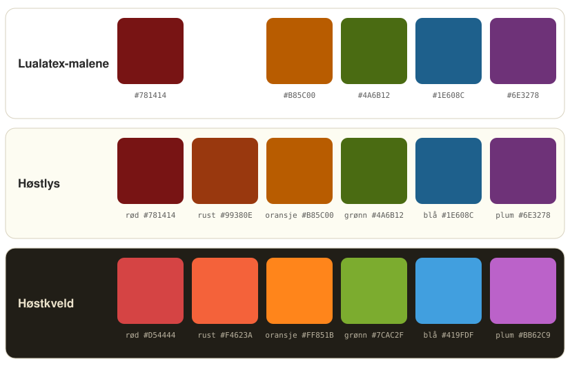

# Høst-paletten

Fargene i Høst-familien: lualatex-malene, VS Code-temaene Høstlys og Høstkveld, og terminalen. Høstlys bygger på de fem fargene fra malene og legger til rust. Høstkveld er regnet ut fra Høstlys etter én regel, slik at fargene har samme rekkefølge og samme roller i begge temaene. Kontrasten er målt mot editorbakgrunnen (minst 4,5 anbefales for vanlig tekst, 3 for fet).

## Slik endres fargene

Alle hex-kodene står i `palett.py`, og bare der. `bygg.py` lager de to temafilene i `themes/`, iTerm-filene i `configs/iterm2/farger/` og `palett.svg` ut fra paletten. Gangen er:

1. Endre fargen i `palett.py` (eller en regel i `bygg.py`).
2. Kjør `python3 bygg.py`. Med `--sjekk` skrives kontrasten for tekstfargene ut i tillegg.
3. Øk `version` i `package.json`, pakk utvidelsen med `npx @vscode/vsce package -o host-theme.vsix` og installer den på nytt med `setup.sh`. VS Code installerer ikke en pakke med samme versjonsnummer som den som allerede er installert, så uten et nytt nummer beholdes de gamle fargene.

Temafilene i `themes/` skal ikke redigeres for hånd, siden de skrives over neste gang `bygg.py` kjøres. Mappa `eksempler/` har en fil for hvert språk, og der ser man raskt hvordan en endring slår ut.

## Hva fargene betyr

Malene bruker rødt sparsomt: til hyperlenker, rammer rundt viktige resultater og skillelinjer. Struktur vises med svart og fet skrift, og palettfargene bærer innholdet. Temaene følger samme tanke. Rødt er landemerker og henvisninger, rust er struktur, og de fire andre fargene er innhold.

- **Rød**: landemerker og henvisninger. `\section` og de andre seksjonskommandoene (fete), `\ref`, `\eqref`, `\cite`, `\url` og `\href` med nøkkel og adresse, lenker i Markdown og i grensesnittet, `#` foran overskrifter i Markdown, feil, og fjernede linjer i diff.
- **Rust**: struktur. `\begin` og `\end` (fete), preamblen (`\documentclass`, `\usepackage`, `\usetikzlibrary`, `\definecolor`), definisjoner (`\newcommand`, `\NewDocumentCommand`, `\newtheorem`, `\def`), `\item`, TeX-betingelser som `\ifdefined` og `\fi`, listetegn i Markdown, posttypen i BibTeX (`@book`), nøkkelord i Python, skallskript og andre språk, tagger i HTML og XML, og ordene i en tikz-bane (`node`, `at`, `cycle`). Tallmerker i grensesnittet, for eksempel på kildekontroll-ikonet.
- **Oransje**: tall og konstanter som `True`, `False` og `None`. Navn med store bokstaver i Python (`M`, `G`, `GRENSE`) har tekstfarge som andre variabler, siden enkeltbokstaver som `M` er vanlige variabler i fysikkode. I grensesnittet: aktivt linjenummer, søketreff, endrede filer og advarsler.
- **Grønn**: funksjoner og miljøer. Miljønavnet i `\begin{equation}` (fet), navnet på nye kommandoer (`\newcommand{\dd}`), tegnekommandoer i tikz (`\draw`, `\node`, `\addplot`), funksjonsnavn i Python, og lagt til i diff.
- **Blå**: strenger og matematikk. Alt inne i `$...$`, `\[...\]` og matte-miljøer, verbatim og `\texttt`, strenger i Python med prefikset `f` eller `r`, og kode i teksten i Markdown.
- **Plum**: typer og symboler. Greske bokstaver og symboler som `\gamma`, `\infty` og `\Longrightarrow`, klasser og typer i Python (`Planet`, `float`), `self` og `cls`, dekoratorer, spesialtegn i f-strenger og regulære uttrykk, innebygde typer i C og liknende (`int`, `double`), `this` og `super`, attributter i HTML, og nøkler i JSON, YAML, BibTeX og LaTeX-opsjoner.
- **Grå**: det som støtter innholdet: klammer, parenteser, `$`, kommentarer og sitater.
- **Tekstfarge**: prosa, variabler, parametere, operatorer og vanlige LaTeX-kommandoer som `\frac`, `\emph`, `\caption` og `\label`.

## Fet skrift

Fet skrift er for det man vil finne når man blar:

- LaTeX: seksjonskommandoer og titlene deres, og miljøer (`\begin`, `\end` og navnet).
- Python: kontrollord og logiske ord: `def`, `class`, `if`, `elif`, `else`, `for`, `while`, `return`, `break`, `continue`, `pass`, `raise`, `try`, `except`, `finally`, `with`, `yield`, `match`, `case`, `and`, `or`, `not`, `in` og `is`. `import`, `from`, `as`, `lambda` og `async` er ikke fete.
- Markdown: overskrifter.

## Lualatex-malene

Definert i stilfilene til malene (for eksempel `handoutstyle.sty`).

| Farge | Navn i malen | Hex |
|---|---|---|
| Rød | `darkred` | `#781414` |
| Oransje | `darkorange` | `#B85C00` |
| Grønn | `darkolive` | `#4A6B12` |
| Blå | `darkblue` | `#1E608C` |
| Plum | `darkplum` | `#6E3278` |

## Høstlys (VS Code, lyst)

| Rolle | Hex | Kontrast |
|---|---|---|
| Rød | `#781414` | 10,7 |
| Rust | `#99380E` | 7,0 |
| Oransje | `#B85C00` | 4,5 |
| Grønn | `#4A6B12` | 6,0 |
| Blå | `#1E608C` | 6,6 |
| Plum | `#6E3278` | 8,5 |
| Tekst | `#282828` | 14,3 |
| Klammer | `#7C6F64` | 4,7 |
| Kommentarer | `#928374` | 3,6 |
| Editor | `#FDFCF2` | |
| Ramme | `#F4F1E4` | |
| Markering | `#E2D8BF` | |
| Søketreff | `#E8CCA9` | |

Rød, oransje, grønn, blå og plum er de samme som i malene. Rust ligger nøyaktig midt mellom rød og oransje i lyshet, metning og kulør, så overgangen rød, rust, oransje blir jevn.

Fjernede linjer i diff har bakgrunn i rust med lav dekkevne. Rød med lav dekkevne blir rosa på den lyse bakgrunnen.

## Høstkveld (VS Code, mørkt)

| Rolle | Hex | Kontrast |
|---|---|---|
| Rød | `#D54444` | 3,8 |
| Rust | `#F4623A` | 5,3 |
| Oransje | `#FF851B` | 6,8 |
| Grønn | `#7CAC2F` | 6,2 |
| Blå | `#419FDF` | 5,7 |
| Plum | `#BB62C9` | 4,5 |
| Tekst | `#EBE2CB` | 12,9 |
| Klammer | `#A3978C` | 5,8 |
| Kommentarer | `#928374` | 4,5 |
| Editor | `#211E17` | |
| Ramme | `#2D271D` | |
| Markering | `#443D30` | |
| Søketreff | `#5C4220` | |

De seks fargene er regnet ut fra Høstlys i fargerommet OKLCH, der like tallforskjeller oppleves omtrent like store:

- **Lyshet**: L = 0,281 + 0,837 · L i Høstlys. Fargene får samme rekkefølge og samme avstander som i Høstlys, skalert opp til mørk bakgrunn.
- **Metning**: 1,35 ganger metningen i Høstlys, likt for alle.
- **Kulør**: samme som i Høstlys. Rød, rust og oransje flyttes 2 til 4 grader mot rødt, fordi lyse farger ellers oppleves gulere enn mørke.

Rødt har lavest kontrast. Det brukes mest på fete overskrifter og korte henvisninger, der det leses greit. Oransje når grensen for hva en vanlig skjerm kan vise, så i praksis øker metningen bare 1,24 ganger for den. Rammen er lysere enn editoren, og det er ingen kantlinjer.

## Terminal

Terminalen har bare åtte fargeplasser (svart, rød, grønn, gul, blå, magenta, cyan og hvit), pluss en lys variant av hver. Plassene får palettfargene: gul er oransje, magenta er plum, og cyan er rust. Dermed finnes alle seks fargene i terminalen, og turkis dukker aldri opp. Alt som bruker fargeplassene, følger med når man bytter mellom Høstkveld og Høstlys: fastfetch, prompten, `ls`, git og syntaksfargene i kommandolinja. De lyse variantene er de samme fargene litt lysere.

Rollene er de samme som i editoren: rust for nøkkelord og git-feltet med endringer, oransje for mapper, stifeltet og opsjoner, grønt for kommandoer, blått for tekst i anførselstegn, plum for variabler og lenker, og rødt for feil.

### Høstlys (VS Code og iTerm)

Bakgrunn `#FDFCF2`, tekst `#282828`, markering `#E2D8BF`.

| Plass | Vanlig | Lys |
|---|---|---|
| Svart | `#282828` | `#7C6F64` |
| Rød | `#781414` | `#8F2C28` |
| Grønn | `#4A6B12` | `#5D802C` |
| Gul (oransje) | `#B85C00` | `#D07128` |
| Blå | `#1E608C` | `#3575A2` |
| Magenta (plum) | `#6E3278` | `#83468D` |
| Cyan (rust) | `#99380E` | `#B04D28` |
| Hvit | `#E2DCC8` | `#FDFCF2` |

### Høstkveld i VS Code

Bakgrunn `#211E17`, tekst `#EBE2CB`, markering `#443D30`.

| Plass | Vanlig | Lys |
|---|---|---|
| Svart | `#38332A` | `#928374` |
| Rød | `#D54444` | `#EE5C58` |
| Grønn | `#7CAC2F` | `#91C349` |
| Gul (oransje) | `#FF851B` | `#FF9C3D` |
| Blå | `#419FDF` | `#59B5F7` |
| Magenta (plum) | `#BB62C9` | `#D278E0` |
| Cyan (rust) | `#F4623A` | `#FF7951` |
| Hvit | `#EBE2CB` | `#F7F0DE` |

### Høstkveld i iTerm

Bakgrunn `#211E17`, tekst `#F3ECDA`, markering `#4D4535`, fet tekst `#FFFAF0`.

Høstkveld gløder litt mer i iTerm enn i VS Code: lysheten er 0,04 høyere og metningen 1,10 ganger større. Terminalen ser man på i korte økter, og vinduet er halvgjennomsiktig, så fargene tåler å være sterkere. Oransje er allerede så mettet som en vanlig skjerm kan vise.

| Plass | Vanlig | Lys |
|---|---|---|
| Svart | `#38332A` | `#A39584` |
| Rød | `#EB4749` | `#FF605E` |
| Grønn | `#85BA2A` | `#9AD147` |
| Gul (oransje) | `#FF8C00` | `#FFA334` |
| Blå | `#41ACF4` | `#5AC3FF` |
| Magenta (plum) | `#CC69DC` | `#E47FF4` |
| Cyan (rust) | `#FF6739` | `#FF7E52` |
| Hvit | `#EFE7D2` | `#FFFAF0` |

### Prompten i Høstlys

Feltene i prompten (Powerlevel10k) har mørk tekst, som passer Høstkveld. I Høstlys er oransje og rust mørke, så teksten der må være lys. `.p10k.zsh` bytter til lys tekst når `HOST_TEMA=lys` er satt, eller når iTerm-profilen har «lys» i navnet. Tavle-profilen i VS Code setter `HOST_TEMA=lys` for terminalen sin, siden den bruker Høstlys.

## Hva temaet dekker

Grensesnittet har farger fra paletten overalt, også i diff- og flettevisning, peek, feilsøking, tester, Jupyter-notebooks, kommandopaletten, menyer, innstillinger og chat. Ingen deler faller tilbake på VS Codes egne blå- og turkistoner.

Koden fargelegges for LaTeX (med LaTeX Workshop), BibTeX, Python, Markdown med matematikk, JSON, YAML, skallskript, diff, git-commits og loggene i Output-panelet. For Python er semantisk utheving slått på, slik at Pylance kan skille klasser, funksjoner, konstanter og `self` også der grammatikken ikke klarer det.

LaTeX Workshop-grammatikken kjenner igjen mye, men lar en del vanlig innhold stå som ren tekst. Utvidelsen har derfor fire små tilleggsgrammatikker i `syntaxes/`. De endrer bare fargene, ikke hvordan resten av fila tolkes:

- `latex-host.injection.json`: definisjoner og preamble (`\NewDocumentCommand`, `\DeclareMathOperator`, `\newtheorem`, `\definecolor`, `\usetikzlibrary` og liknende får samme rolle som `\newcommand` og `\usepackage`), tall og enheter i siunitx (`\qty`, `\num`, `\unit`), kjemi i mhchem (`\ce`) og filstier (`\includegraphics`, `\addbibresource`, `\graphicspath`).
- `latex-host-opsjoner.injection.json`: nøkler og verdier i opsjoner, som `[width=0.8\linewidth]`, `[label=\alph*)]` og `\hypersetup{colorlinks=true}`, og mål som `2mm` og `11pt`.
- `latex-host-tikz.injection.json`: innholdet i tikzpicture: tall og enheter, nøkler i opsjoner og ordene i en tegnebane (`node`, `at`, `cycle`, `circle`, `to`).
- `latex-host-tikzmiljo.injection.json`: gjør at `circuitikz` og `tikzcd` fargelegges som tikz.

I siunitx er tallet oransje og enheten tekst, også i matte, der enheten ellers ville blitt blå som en variabel. Kjemiske formler er blå som matte, og filstier er blå som strenger.
